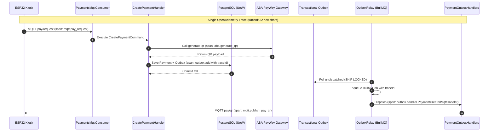

# Phase 8: Observability

This document details the implementation of **Phase 8: Observability** for the Smart IoT Water Refill Machine (WRM) backend, implementing [Backend Architecture §13](file:///D:/water-refill-machine-backend/docs/04-Cloud-and-Payment/backend-architecture.md#13-observability), [Deployment §10](file:///D:/water-refill-machine-backend/docs/06-Testing-and-Operations/deployment.md#10-monitoring--alerting), and [Implementation Plan Part B6](file:///D:/water-refill-machine-backend/docs/04-Cloud-and-Payment/backend-implementation-plan.md#b6-logging-tracing-metrics).

---

## 1. Overview & Capabilities

Phase 8 elevates the backend to enterprise-grade observability:
1. **OpenTelemetry Distributed Tracing:** Follows every payment end-to-end in a **single trace** across the asynchronous boundary: MQTT (`pay/request`) $\to$ Command Handler $\to$ PostgreSQL $\to$ ABA PayWay $\to$ Transactional Outbox $\to$ Outbox Relay (BullMQ) $\to$ MQTT (`pay/qr` or `pay/status: paid`).
2. **Prometheus Metrics Engine & `/metrics` Endpoint:** Implements the complete Plan B6 metric suite in [apps/api/src/platform/metrics/](file:///D:/water-refill-machine-backend/apps/api/src/platform/metrics/) and exposes `GET /metrics` formatted for Prometheus scrapers.
3. **Pino Structured Logging with Context Correlation:** Automatically attaches `traceId`, `tranId`, `machineId`, `requestId`, and `jobId` to every structured log statement via `AsyncLocalStorage`, with strict production redaction for secrets, keys, and QR strings.
4. **Grafana Dashboards as Code:** Production JSON dashboards in [infra/grafana/dashboards/](file:///D:/water-refill-machine-backend/infra/grafana/dashboards/) with automated datasource and dashboard provisioning.
5. **Deployment §10 Alert Rules:** Declarative alert definitions in [infra/prometheus/rules/alerts.yml](file:///D:/water-refill-machine-backend/infra/prometheus/rules/alerts.yml) covering all 15 system health and operational failure signals with automated simulation test coverage.
6. **Sentry Release Integration:** Release tagging and context enrichment in [apps/api/src/platform/telemetry/](file:///D:/water-refill-machine-backend/apps/api/src/platform/telemetry/) hooked into the global exception filter.

---

## 2. Distributed Tracing Architecture

### Single Payment Trace Flow


### Trace Context Propagation Mechanism
- **W3C Format:** Standard 128-bit `traceId` (32 hex characters) and 64-bit `spanId` (16 hex characters).
- **Outbox Persistence:** `traceId` is stored inside `outbox.payload` as `{ eventId, type, version, occurredAt, traceId, data }`.
- **Relay Dispatch:** `OutboxRelay` extracts `row.payload.traceId` and propagates it into BullMQ job execution.
- **TracerService:** In [apps/api/src/platform/telemetry/tracer.service.ts](file:///D:/water-refill-machine-backend/apps/api/src/platform/telemetry/tracer.service.ts), `BasicTracerProvider` with `InMemorySpanExporter` and context propagation binds spans to the parent trace.

---

## 3. Plan B6 Prometheus Metrics Catalog

All metrics are registered in [apps/api/src/platform/metrics/metrics.service.ts](file:///D:/water-refill-machine-backend/apps/api/src/platform/metrics/metrics.service.ts) and exposed via `GET /metrics`.

| Metric Name | Type | Labels | Description |
|---|---|---|---|
| `wrm_payments_created_total` | Counter | `machine`, `currency` | Total number of payment requests created |
| `wrm_payments_status_total` | Counter | `status` | Total payments transitioned into a given status |
| `wrm_payment_time_to_paid_seconds` | Histogram | — | Time in seconds from payment creation to confirmation (paid) |
| `wrm_late_payments_total` | Counter | — | Total number of late payments detected after terminal state |
| `wrm_aba_request_duration_seconds` | Histogram | `operation`, `outcome` | Duration of ABA PayWay API requests in seconds |
| `wrm_aba_check_failures_total` | Counter | — | Total number of ABA check-transaction probe failures |
| `wrm_aba_circuit_state` | Gauge | — | State of ABA circuit breaker (0=closed, 1=half-open, 2=open) |
| `wrm_outbox_lag_seconds` | Gauge | — | Age in seconds of oldest undispatched event in outbox |
| `wrm_queue_depth` | Gauge | `queue` | BullMQ queue depth (waiting + delayed jobs) |
| `wrm_machines_online` | Gauge | — | Total number of machines currently online |
| `wrm_pay_request_throttled_total` | Counter | — | Total rate-limited payment requests |
| `wrm_transaction_ack_total` | Counter | `status` | Transaction outcome ACKs returned (`ok` vs `rejected`) |
| `wrm_pending_outcomes` | Gauge | `machine` | Pending outcomes reported in machine heartbeats |
| `wrm_dispense_accuracy_diff_percent`| Histogram | — | Percentage discrepancy between flow meter and load cell |
| `wrm_dispense_unknown_open` | Gauge | — | Count of payments in `DISPENSE_UNKNOWN` status |
| `wrm_refund_cases_open` | Gauge | — | Count of open or claimed refund cases |
| `wrm_node_*` | Various | — | Node.js process CPU, memory, event loop lag, handles |

---

## 4. Structured Logging & Context Correlation

Structured logging is handled by Pino in [apps/api/src/platform/logging/](file:///D:/water-refill-machine-backend/apps/api/src/platform/logging/):
- **Correlation Storage:** [correlation-context.ts](file:///D:/water-refill-machine-backend/apps/api/src/platform/logging/correlation-context.ts) uses Node.js `AsyncLocalStorage`.
- **Automatic Field Injection:** Every logger call (`this.logger.log(...)`) automatically includes:
  ```json
  {
    "level": "info",
    "time": 1731580000000,
    "msg": "Publishing pay/qr for tran-001",
    "traceId": "4bf92f3577b34da6a3ce929d0e0e4736",
    "tranId": "mwdk383i68c9579706",
    "machineId": "WRM-001",
    "requestId": "req-1234567890abcdef"
  }
  ```
- **Redaction Policy:** Paths matching `password`, `apiKey`, `api_key`, `hash`, `qrString`, `qr_string`, `WIFI_PASSWORD`, `MQTT_PASSWORD`, `secret`, `authSecret`, and `req.headers.authorization` are scrubbed and replaced with `[REDACTED]`.

---

## 5. Grafana Dashboards as Code

Six pre-configured production Grafana dashboards are located in [infra/grafana/dashboards/](file:///D:/water-refill-machine-backend/infra/grafana/dashboards/):
1. **[payments-and-revenue.json](file:///D:/water-refill-machine-backend/infra/grafana/dashboards/payments-and-revenue.json):** Success rate gauge (15m), payment creation rate by currency, time-to-paid p50/p95 latency, status transition timeline, throttled requests & late payment events.
2. **[aba-payway-gateway.json](file:///D:/water-refill-machine-backend/infra/grafana/dashboards/aba-payway-gateway.json):** Circuit breaker state, ABA API latency percentiles (p50, p95, p99), check-transaction failure rates, calls per minute breakdown by operation.
3. **[kiosk-fleet.json](file:///D:/water-refill-machine-backend/infra/grafana/dashboards/kiosk-fleet.json):** Online fleet count, per-kiosk pending outcomes in NVS storage, transaction ACK volume.
4. **[outcomes-and-acks.json](file:///D:/water-refill-machine-backend/infra/grafana/dashboards/outcomes-and-acks.json):** Dispense sensor accuracy discrepancy histogram ($|flow - weight| / target$), accepted vs rejected outcome ACKs.
5. **[queues-outbox-sweeps.json](file:///D:/water-refill-machine-backend/infra/grafana/dashboards/queues-outbox-sweeps.json):** Outbox lag gauge, BullMQ job queue depths, dispatch throughput.
6. **[refunds.json](file:///D:/water-refill-machine-backend/infra/grafana/dashboards/refunds.json):** Open refund cases count, payments in `DISPENSE_UNKNOWN`, late payment tracking.
7. **[infrastructure.json](file:///D:/water-refill-machine-backend/infra/grafana/dashboards/infrastructure.json):** Process CPU user/system %, heap and RSS memory allocation, Node.js event loop lag.

Automated provisioning is configured via:
- [infra/grafana/provisioning/dashboards/dashboards.yml](file:///D:/water-refill-machine-backend/infra/grafana/provisioning/dashboards/dashboards.yml)
- [infra/grafana/provisioning/datasources/datasources.yml](file:///D:/water-refill-machine-backend/infra/grafana/provisioning/datasources/datasources.yml)

---

## 6. Deployment §10 Alert Rules & Simulation

All alert rules are defined in [infra/prometheus/rules/alerts.yml](file:///D:/water-refill-machine-backend/infra/prometheus/rules/alerts.yml).

| Alert Name | Severity | Condition | Description |
|---|---|---|---|
| `ApiDown` | critical | `up == 0` for 1m | Backend instance is down |
| `PaymentSuccessRateLow` | critical | `success_rate < 95%` for 5m | Payment success rate drop |
| `AbaLatencyHigh` | warning | `p95 > 5s` for 2m | ABA PayWay API latency degradation |
| `AbaErrorSpike` | critical | `error_rate > 0.1` for 1m | ABA PayWay gateway error surge |
| `OutboxLagCritical` | critical | `wrm_outbox_lag_seconds > 30` for 1m | Outbox relay stalled |
| `QueueDepthGrowing` | warning | `deriv(depth) > 0` and `depth > 50` for 5m | BullMQ queue accumulating |
| `SweepsStalled` | critical | `now - last_sweep > 300s` for 2m | Background cron sweep stalled |
| `AbaCheckFailuresHigh` | warning | `check_failures > 5%` for 5m | High ABA status probe failure rate |
| `LatePaymentDetected` | warning | `increase(late_payments) > 0` | Customer paid after expiry/cancel |
| `MachineOffline` | warning | `machines_online < 1` for 3m | Fleet offline alert |
| `PendingOutcomesStuck` | warning | `pending_outcomes > 0` for 1h | NVS outcomes stuck on kiosk |
| `DispenseOutcomeUnknown` | critical | `dispense_unknown > 0` for 1m | Payment in UNKNOWN dispense state |
| `RefundCaseStale` | warning | `open_refunds > 0` for 24h | Unaddressed customer refund case |
| `OutcomeRejected` | critical | `increase(ack_rejected) > 0` | Kiosk outcome rejected |
| `HostResourcesHigh` | warning | `cpu_usage > 80%` for 5m | High CPU utilization |

### Automated Simulation Suite
The test suite in [apps/api/test/observability.spec.ts](file:///D:/water-refill-machine-backend/apps/api/test/observability.spec.ts) runs full simulation across:
1. Validating single payment trace consistency across all 4 hops.
2. Validating all 16 metrics record, observe, and output to Prometheus format.
3. Evaluating every single Deployment §10 alert rule against healthy vs degraded state.
4. Verifying correlation context preservation in `AsyncLocalStorage`.

---

## 7. Verification & Run Commands

```powershell
# 1. Run unit & observability simulation tests
pnpm --filter @wrm/api test test/observability.spec.ts

# 2. Run complete monorepo unit test suite (18 test files, 164 tests)
pnpm test:unit

# 3. Check architectural dependency boundaries (0 violations)
pnpm --filter @wrm/api depcruise

# 4. Typecheck all workspaces
pnpm typecheck

# 5. Run ESLint (0 errors)
pnpm lint

# 6. Production build test (api + dashboard)
pnpm build
```

---

## 8. Definition of Done Checklist

- [x] One payment followed in a single trace (MQTT $\to$ Command $\to$ DB $\to$ ABA $\to$ Outbox $\to$ Relay $\to$ MQTT)
- [x] All Deployment §10 alerts tested by simulation
- [x] Structured logs carry `traceId`, `tranId`, `machineId` with sensitive redaction
- [x] Prometheus `/metrics` endpoint active with all Plan B6 metrics
- [x] Grafana dashboards as code provisioned
- [x] `docs/PROGRESS.md` updated with handoff note
